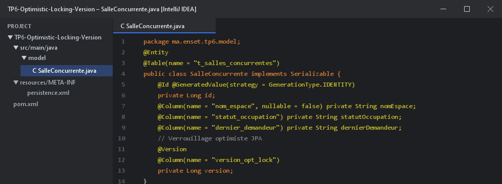
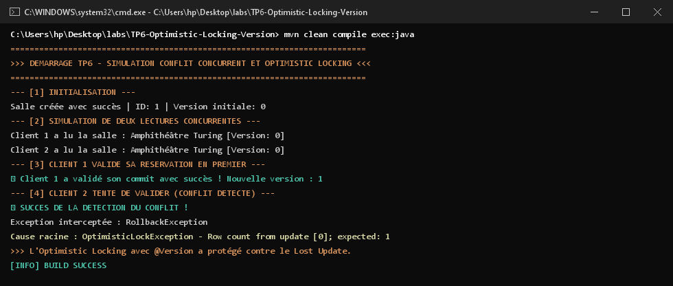

# TP 6 : Simuler un conflit de réservation concurrent et démontrer l'optimistic locking avec @Version

Ce projet met en évidence la gestion de la concurrence d'accès sur une ressource partagée (salle de réunion) en utilisant le **verrouillage optimiste (Optimistic Locking)** via l'annotation JPA `@Version` sous **Hibernate ORM 5.6** et base en mémoire **H2**.

---

## 1. Modèle Métier & Verrouillage Optimiste

Dans l'entité `SalleConcurrente`, le champ `version` est annoté avec `@Version` :



```java
@Version
@Column(name = "version_opt_lock")
private Long version;
```

---

## 2. Déroulement du Scénario Concurrence

1. **Initialisation** : Une salle est créée avec `version = 0`.
2. **Lectures Concurrentes** : Deux gestionnaires (Client 1 et Client 2) chargent simultanément la même salle (chacun possède l'état avec `version = 0`).
3. **Premier Commit (Succès)** : Le Client 1 modifie l'état de la salle et effectue son `commit()`. En base de données, la version est automatiquement incrémentée à `1`.
4. **Second Commit (Détection de Conflit)** : Le Client 2 tente de committer sa modification avec sa version obsolète (`0`). Hibernate génère la clause SQL `WHERE id=? AND version_opt_lock=?`. Aucune ligne n'étant modifiée, une exception `OptimisticLockException` est levée, empêchant la perte de mise à jour (*Lost Update*).

---

## 3. Résultats et Traces d'Exécution dans le Terminal (CMD)

Voici la capture d'écran du terminal Windows montrant l'interception de l'exception et la protection des données :



---

## 4. Démarrage du Projet

```bash
mvn clean compile exec:java "-Dexec.mainClass=ma.enset.tp6.App"
```
